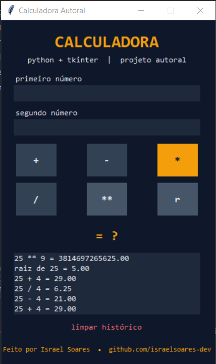

# Calculadora Gráfica

Esta é a segunda versão da minha calculadora em Python. A [primeira](https://github.com/israelsoares-dev/calculadora-python) rodava só no terminal. Nesta eu quis dar o próximo passo: criar uma janela de verdade, com botões, e deixar com a minha cara.



## O que ela faz

Soma, subtração, multiplicação, divisão, potência e raiz quadrada. Dá para digitar `2,5` ou `2.5`, tanto faz.

Se alguém digitar letras, deixar um campo vazio, dividir por zero ou tentar tirar a raiz de um número negativo, ela avisa em vermelho em vez de travar.

Cada conta fica guardada num histórico. Quando você fecha e abre o programa de novo, as contas anteriores continuam lá. Também tem um botão para limpar tudo se quiser recomeçar.

## Como rodar

Você só precisa do [Python 3](https://www.python.org/downloads/) instalado. O Tkinter, que cria a janela, já vem junto com ele.

Baixe o projeto, abra a pasta no terminal e rode:

```bash
python main.py
```

## O que eu aprendi fazendo

- Montar a janela com `grid()` e entender que não dá para misturar com `pack()`
- Separar o que é cálculo do que é visual, para o código não virar bagunça
- Guardar o histórico em um arquivo e carregar de volta ao abrir
- Tratar os erros com `try/except` pensando em tudo que o usuário pode digitar errado
- Mexer no visual: cores, fontes e o efeito dos botões ao passar o mouse

## Sobre mim

Sou o Israel, estudante de Análise e Desenvolvimento de Sistemas e estou aprendendo Python na prática, projeto por projeto. Este é um deles.

GitHub: [israelsoares-dev](https://github.com/israelsoares-dev)